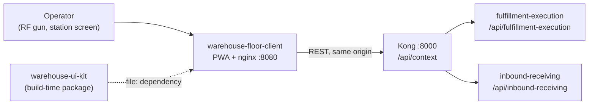

# Integration

The floor client is a **client, not a bounded context**: it owns no aggregate,
publishes no event and has no database. It is a downstream **Conformist** to the
published OpenAPI of each context it talks to (`apis/openapi.yaml` in the owning
repo), and it reaches them in exactly one way: same-origin `/api/<context>/...`
through Kong. This page lists every edge, what travels over it and what the
client does when it fails. The wire-level request/response tables are in the
[API contract](./api-contract.md).

## Edges at a glance

Source: `src/api/fulfillmentExecution.ts` (`FULFILLMENT_BASE`),
`src/api/inboundReceiving.ts` (`RECEIVING_BASE`), `package.json`,
`vite.config.ts`.

| Direction | Peer | Protocol | Used for | In code |
|---|---|---|---|---|
| Downstream of | fulfillment-execution | REST/JSON through Kong, `application/problem+json` errors | register a station, check in/out, claim the next task, renew its lease, scan-confirm a pick, break a case, complete | `src/api/fulfillmentExecution.ts` |
| Downstream of | inbound-receiving | REST/JSON through Kong | list and read receipts, receive scans, close a receipt, fetch a carton label | `src/api/inboundReceiving.ts` |
| Build-time | warehouse-ui-kit | npm `file:../warehouse-ui-kit` (sibling checkout) | `AppShell`, `Card`, `StatusPill`, `NavigationProvider`, design tokens | `package.json`, `src/app/Layout.tsx`, `src/main.tsx` |
| Edge | Kong | HTTP on the page's own origin | routes every `/api/<context>` | `vite.config.ts` (dev proxy), `nginx.conf` (guard) |
| Documented but absent | inventory-storage, workforce-management | n/a | `AGENTS.md` names them as target contexts; no code calls them | none |

Nothing calls the floor client: it exposes no API, no webhook and no event.
There is no Kafka, no MCP and no A2A surface, and no authentication in either
direction (the fleet is unauthenticated by decision).

## Ground rules for every edge

- **Kong only, same origin.** Every request is a relative path such as
  `/api/fulfillment-execution/stations`. No absolute URL, no service host or
  port, no BFF, no runtime config. `src/lib/outbox.ts` additionally drops any
  persisted entry whose path does not start with `/api/`.
- **One context per screen.** A screen calls only the API of its own context; a
  flow that needs two contexts would make two explicit calls and show each
  result. Today station and task screens use fulfillment-execution only and the
  receiving screens use inbound-receiving only.
- **Commands carry an `Idempotency-Key`**, minted once per operator action and
  reused on every retry; reads (`GET`) carry none.
- **Errors are for operators.** `application/problem+json` is keyed on the last
  path segment of `type`; `detail` and raw JSON are never shown.
- **Conformist.** Task types, states and error codes are taken from the owning
  spec; the client invents no field.

## fulfillment-execution

Base path `/api/fulfillment-execution`. Contract: `apis/openapi.yaml` in
IQVO/fulfillment-execution (`origin/develop`).

| Operation | Request | When |
|---|---|---|
| Register | `POST /stations` | station screen; upsert, also used to re-register |
| Check in / out | `POST /stations/{id}/check-in`, `.../check-out` | badge scan; check-out button |
| Claim | `POST /stations/{id}/claim-next` `{taskType}` | Pick, Relocate, Replenish buttons (`CLAIMABLE_TASK_TYPES`) |
| Renew lease | `POST /tasks/{id}/renew-lease` | automatic at half-life; never queued |
| Pick scan | `POST /tasks/{id}/scans` `{stationId, gtin, count}` | each item or case scan on a PICK task |
| Break case | `POST /tasks/{id}/break-case` `{stationId}` | the `BREAK_CASE` task screen |
| Complete | `POST /tasks/{id}/complete` | after the confirmation scans |

Behaviour to rely on:

- The service grants a **lease** on `claim-next` (5 minutes by default). The
  client learns the length from `leaseExpiry` minus the response `Date`, keeps
  the deadline in the local clock and renews at half-life.
- fulfillment-execution applies its `Idempotency-Key` middleware to
  `POST /tasks` only. The station and task endpoints used here ignore the key,
  so a replay after a lost answer is **not** deduplicated by the service.
  `complete` replays resolve through `409 task-already-completed` (treated as
  done); `claim-next` replays can lease a second task, which the client leaves
  to expire; `check-in` replays can see `409 station-occupied`.
- `BREAK_CASE` is created and completed by the service, but the OpenAPI
  `AnyTaskType` does not list it, so the client does not offer to claim it
  (`CLAIMABLE_TASK_TYPES`); the task screen handles it when one is held.
- The error copy for `case-break-rejected` and `case-break-unavailable` speaks
  of "the storage system": the break is carried out by the service behind
  Kong (inventory-storage, per `PickScan.test.tsx`), not by the client.

### Failure behaviour

| Answer | Client behaviour |
|---|---|
| network error, timeout (15 s), `429`, `502`, `503`, `504` | commands: saved in the outbox, same key, replayed FIFO (on `online`, at load, every 5 s, "Retry now"). `renew-lease`: not queued, retried every 10 s |
| `409 no-claimable-task` | calm "nothing waiting" message |
| `404 station-not-found` | tells the operator to register the station again |
| `409/404 task-not-claimed`, `task-not-owner`, `task-not-found` on renew, scan, complete or break | the held task is dropped; operator pulls the next one |
| `409 task-already-completed` on complete or break | treated as success |
| any other `4xx`/`5xx` | final: removed from the outbox, shown as plain words |

## inbound-receiving

Base path `/api/inbound-receiving`. Contract: `apis/openapi.yaml` in
IQVO/inbound-receiving (`origin/develop`). Flow: [Receiving flow](/docs/overview/receiving-flow).

| Operation | Request | Command or read |
|---|---|---|
| List open receipts | `GET /receipts?state=Open&limit=50` | read (first page only) |
| Get a receipt | `GET /receipts/{receiptId}` | read |
| Receive a scan | `POST /receipts/{receiptId}/scans` | command, key required |
| Close | `POST /receipts/{receiptId}/close` | command |
| Carton label data | `GET /receipts/{receiptId}/cartons/{lpn}/label` | read |

Behaviour to rely on:

- Unlike fulfillment-execution, inbound-receiving **does** deduplicate
  `POST /scans` by `Idempotency-Key` (per its OpenAPI): the same key and body
  returns the original answer, another body is `422 idempotency-key-reused`, a
  missing key is `400 idempotency-key-required`. This is read from the spec and
  has not been exercised against a live service from this repo; the stub
  implements the same rule.
- The service computes every quantity (cases to eaches, running receipt lines);
  the device multiplies nothing.
- A refused scan is `200` with `accepted: false`; an accepted scan is `201`,
  possibly with findings (nine `CartonDiscrepancyKind`s). A finding is not an
  error.
- `If-Match` is not sent; concurrent writers are serialised by the service
  (`409 concurrent-modification`, shown as "scan again").
- `GET /asns/{asnNumber}/cartons` exists and is unused.
- Spec observation: the OpenAPI example SSCC `340123450000000013` has an invalid
  GS1 check digit; the client rejects it before any request.

### Failure behaviour

| Answer | Client behaviour |
|---|---|
| network error, timeout, `429/502/503/504` on a scan or close | saved with its key and replayed |
| a read (`GET`) fails | the screen shows the problem or an "unreachable" note; reads are never queued or cached |
| `dependency-unavailable`, `version-mismatch`, `concurrent-modification` | operator copy from `src/api/receivingMessages.ts` |
| slug the build does not know | falls back to the service's `title` plus "call your lead" |

## warehouse-ui-kit

`@warehouse/ui-kit` is consumed as `file:../warehouse-ui-kit`, a sibling
checkout, the same way as warehouse-console. It is a build-time dependency
only: locally build it once (`npm ci && npm run build` in the kit), CI checks
it out from `IQVO/warehouse-ui-kit@develop`, and the `Dockerfile` takes it as
the named build context `uikit`. The four runtime dependencies are `react`,
`react-dom`, `react-router-dom` and the kit.

## Relationship to warehouse-console

The console is for supervisors and planners and loads each context's UI as a
Module Federation remote; this app is a standalone PWA for the person holding
the scanner. They share the kit, the Dockerfile approach, the CI job names and
the Kong-only rule, but neither calls the other. Supervisor and planner
screens are not added here.

## Absent edges

- **No cluster deployment in warehouse-infra.** Nothing in `warehouse-infra`
  (`origin/develop`) mentions the floor client, and this repo has no chart; the
  edge that must route `/api` to Kong at the app's host is not defined anywhere
  yet. In the kind cluster the web gateway on `:80` serves HTML only and has
  no `/api` route; Kong listens on `:8000`.
- **No stations list, queue depth or health read.** The client never calls
  `GET /queues/.../depth` or the service health endpoints; only the stub
  implements them.
- **Pack, SLAM, put-wall, stow, cycle-count, transfer-receipt and the shift
  clock** are later work. They are listed in the README under "Not here yet".
