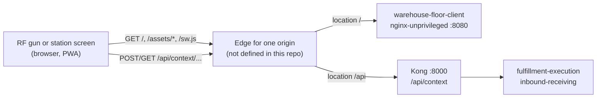

# Runbook

The floor client is a static bundle served by `nginx-unprivileged`. It has no
database, no Kafka, no migrations, no metrics endpoint and no backend process.
Operating it means building the image, putting it behind an edge that sends
`/` to nginx and `/api/` to Kong **at the same origin**, and knowing what the
device does while that edge is unreachable.

:::note What this repo does not ship
There is no Helm chart, no Kubernetes manifest, no registry-publish job and no
release workflow in this repository, and `warehouse-infra` (`origin/develop`)
contains no reference to the floor client. The image is built with
`make image`; deploying it to a cluster is a change in `warehouse-infra`
that does not exist yet. This page documents what the code requires of that
deployment.
:::

## Topology



Source: `nginx.conf`, `vite.config.ts`, `src/api/fulfillmentExecution.ts`
(`FULFILLMENT_BASE`), `src/api/inboundReceiving.ts` (`RECEIVING_BASE`).

The page never calls Kong cross-origin: every request is a relative
`/api/<context>/...` path, so the edge in front of both must route `/api` to
Kong at the page's own host. If it does not, the request reaches this nginx,
which answers `404 application/problem+json` ("No API at this address") rather
than the SPA's `index.html`.

## Artifacts

| Artifact | Where | Produced by |
|---|---|---|
| Image `warehouse-floor-client` | local Docker only | `make image` (`docker build --build-context uikit=../warehouse-ui-kit -t warehouse-floor-client .`) |
| Static bundle `dist/` | inside the image at `/usr/share/nginx/html` | `npm run build` (`tsc -b && vite build`, then `build/precacheManifest.ts` stamps `dist/sw.js`) |
| Docs site | `https://iqvo.github.io/warehouse-floor-client/` | `.github/workflows/docs.yml`, push to `main` touching `docs/**` or `apis/**` |

CI (`ci.yml`) runs `lint`, `test`, `typecheck`, `build` and `docs` and publishes
nothing; CodeQL (`codeql.yml`) scans `javascript-typescript` with
`security-extended` on push, pull request and weekly.

## Building the image

```bash
# from the repo root, with warehouse-ui-kit checked out as a sibling
make image
```

The `Dockerfile` has three stages:

1. `uikit-build` (`node:26-bookworm-slim`): copies the `uikit` named context,
   removes its `node_modules` and lockfile, `npm install --no-save`,
   `npm run build`.
2. `build` (`node:26-bookworm-slim`): places the built ui-kit at
   `/workspace/warehouse-ui-kit`, `npm install --no-save` without the lockfile
   (the committed lock has no Linux optional entries for Vite's native
   bindings), then `npm run build`.
3. runtime (`nginxinc/nginx-unprivileged:1.31-alpine`): `apk upgrade` plus
   pinned `libexpat`, `pcre2`, `tiff` and `libx11` minimums, copies
   `nginx.conf` to `/etc/nginx/conf.d/default.conf` and `dist/` to
   `/usr/share/nginx/html`, runs as `nginx`, `EXPOSE 8080`.

No endpoint is baked in, so one image serves every environment. If the build
fails on a missing sibling, see [Troubleshooting](./troubleshooting.md).

## Running the image

```bash
docker run --rm -p 8080:8080 warehouse-floor-client
curl -s http://localhost:8080/healthz          # ok
curl -si http://localhost:8080/api/anything    # 404 application/problem+json, by design
```

On its own the container serves the shell only; the stations cannot do any work
until `/api` is routed to Kong at the same origin.

### Probes

`GET /healthz` answers `200 ok` from nginx itself. It proves nginx is up, not
that Kong or any service is reachable. Use it for liveness and readiness; do
not read more into it.

## What the device does when the edge is unavailable

Operators on the floor will lose connectivity. This is normal operation, not an
incident:

| Condition | App behaviour |
|---|---|
| Browser offline, or a request cannot reach the edge | the offline banner shows (`OfflineBanner`); commands are saved to the outbox (`wfc.outbox.v1`) with their Idempotency-Key and shown as "saved on this device" |
| Edge answers `429`, `502`, `503` or `504` | treated as retryable: the entry stays in the outbox with the same key |
| Connection returns | the runner replays the outbox FIFO at the `online` event, at page load and every 5 s while anything is pending; "Retry now" does it on demand |
| Lease renewal fails | the countdown shows a warning; renewals are retried every 10 s but never queued |
| Shell requested while offline | the service worker serves the cached `index.html` and hashed assets (only on `https` or `http://localhost`) |

Details: [Offline and idempotency](/docs/overview/offline-and-idempotency).

## Releasing a new bundle

1. Merge to `develop`/`main`, build a new image, roll it out in whatever runs
   the container.
2. `index.html`, `sw.js` and `manifest.webmanifest` are served `no-cache`;
   `/assets/*` are content-hashed and `immutable`. A device picks up the new
   bundle on its next navigation.
3. The service worker cache name is `floor-shell-<12-char content hash>`
   (`build/precacheManifest.ts`). A new worker installs, calls
   `skipWaiting()`, and on activate deletes every older `floor-shell-*` cache.
   A page that is already open keeps running the old JavaScript until it
   reloads.
4. Pending outbox entries survive the upgrade (they are in `localStorage`).
   A change of the outbox or station storage format must bump the `.v1`
   suffix of `wfc.outbox.v1` / `wfc.station.v1` and handle the old value.

Roll back by redeploying the previous image; the same rules apply.

## Routine procedures

### Check a deployment

```bash
curl -s  http://<host>/healthz                       # ok
curl -sI http://<host>/ | grep -i cache-control       # no-cache
curl -sI http://<host>/sw.js | grep -i cache-control  # no-cache
curl -si http://<host>/api/fulfillment-execution/stations/x   # must NOT be the nginx 404 body
```

The last call must reach Kong. If the body contains "No API at this address",
the edge sends `/api` to this nginx instead of Kong.

### Recover a station that shows stale state

The station session lives in `wfc.station.v1`. Registering the station again
(station screen, "Register this station again") upserts it
(`POST /stations`). Clearing site data resets the session **and** drops any
undelivered outbox entry, so check "saved on this device" notices first.

### Use the stub instead of the cluster

```bash
STUB_LEASE_MS=20000 npm run stub-api                         # :8787
FLOOR_API_TARGET=http://localhost:8787 npm run dev            # :5174
```

The stub implements stations, `claim-next`, `renew-lease`, `complete`, queue
depth and the receiving endpoints (receipts, scans, close, carton label) with
the same Idempotency-Key rules as the specs. It does **not** implement the
pick-scan (`POST /tasks/{id}/scans`) or `break-case` endpoints.

## Observability

The client exports no metrics, traces or structured logs, and nothing in
`warehouse-infra` collects from it. What exists:

- nginx access and error logs on the container's stdout/stderr (`/healthz` is
  not logged).
- Browser console lines `[floor] <message> ...` from `src/lib/log.ts`. Request-
  derived values are flattened to one line and capped at 200 characters.
  Warnings are written for: a request that did not reach the edge, an edge
  retry status, a rejected command (kind, status, problem code), a failed
  service worker registration and an extra claim left to expire.
- Operator-facing messages (`NoticeBar`) for every outcome; see the table in
  [API contract](/docs/ecosystem/api-contract).

For diagnosis see [Troubleshooting](./troubleshooting.md).
