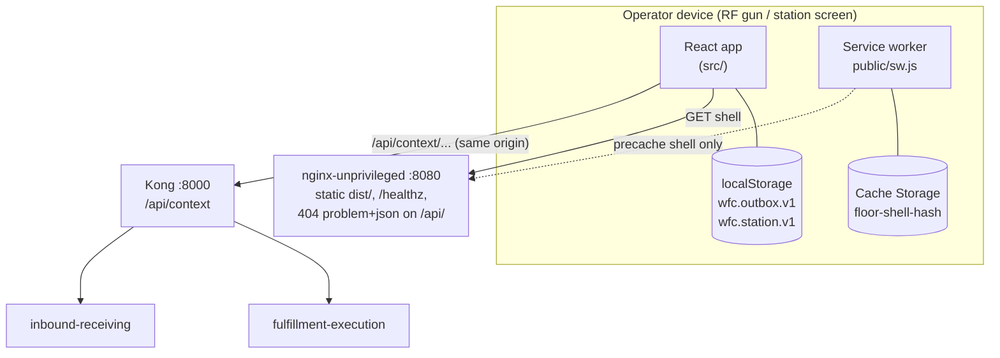

# Architecture

The floor client is a single-page React app with no server side of its own. It
is organised in layers that mirror its one rule: a screen never talks to the
network directly for a write. This is a front end, so there is no hexagonal Go
layout, no `cmd/` binary and no message broker; the "containers" are the
browser, a static nginx and the Kong edge.

## Containers



Source: `nginx.conf`, `vite.config.ts`, `public/sw.js`, `src/main.tsx`,
`src/lib/storage.ts`.

| Container | Role | Port |
|---|---|---|
| React app (`dist/` bundle) | all screens, scan capture, command runner, outbox | served on 8080 |
| nginx-unprivileged | serves the shell, `GET /healthz`, answers `/api/` with `404` problem+json, sets cache headers | 8080 |
| Service worker | precaches the app shell; never touches a non-GET request or anything under `/api/` | n/a |
| Kong (outside this repo) | owns every `/api/<context>` route | 8000 in the kind cluster |
| Dev server (`npm run dev`) | Vite on 5174, proxies `/api` to `FLOOR_API_TARGET` | 5174 |
| Stub API (`npm run stub-api`) | in-memory stand-in for the two services | 8787 |

## Layers

```text
Screen (React)                              src/features/**, src/components/**
   |  asks for an action
   v
StationProvider                             applies outcomes to persisted station state
   |
   v
fulfillmentApi(runner)                      src/api/fulfillmentExecution.ts: builds CommandSpecs
inboundReceivingApi(runner)                 src/api/inboundReceiving.ts
   |
   v
CommandRunner  <---- Outbox (localStorage)  src/lib/commands.ts, src/lib/outbox.ts
   |                  Connectivity          src/lib/connectivity.ts
   v
fetch("/api/<context>/...")  ---->  Kong  ---->  owning context
```

| Directory | Holds | React? |
|---|---|---|
| `src/lib/` | `commands` (runner), `outbox`, `connectivity`, `idempotency`, `scan`, `problem`, `log`, `storage`, `format`; `gs1/` (parser, check digit, resolver), `barcode/` (Code 128 and GS1-128 encoder) | no |
| `src/api/` | `fulfillmentExecution` and `inboundReceiving` clients (command builders, types, `getJson` reads), `problemMessages` and `receivingMessages` (operator text) | no |
| `src/app/` | `servicesContext` (`Services`: store, outbox, connectivity, runner, `fetchFn`, clock), `ServicesProvider`, `Layout`, `RouterLink`, `NotFoundScreen` | yes |
| `src/components/` | `ScanInput`, `OfflineBanner`, `NoticeBar`, `LeaseCountdown`, `Barcode128` | yes |
| `src/features/station/` | `StationProvider`, `StationScreen`, `stationState`, `parseCapabilities` | yes |
| `src/features/task/` | `TaskScreen`, `confirmPlan`, `scanCopy` | yes |
| `src/features/receiving/` | `ReceivingListScreen`, `ReceivingScreen`, `LabelCard`, `scanToRequest` | yes |
| `src/pwa/` | `register` (service worker registration, production only) | no |
| `public/`, `build/` | manifest, icons, hand-written `sw.js`; the Vite plugin `precacheManifest` | n/a |
| `scripts/` | stub API and the two Playwright flows | n/a |

## Routes

Defined in `src/App.tsx` inside `Layout`, which renders the ui-kit `AppShell`,
the `OfflineBanner` and the `NoticeBar` above every screen.

| Path | Screen | Feature |
|---|---|---|
| `/` | `StationScreen` | station |
| `/task` | `TaskScreen` | task |
| `/receiving` | `ReceivingListScreen` | receiving |
| `/receiving/:receiptId` | `ReceivingScreen` | receiving |
| `*` | `NotFoundScreen` | app |

`OutboxReplay` (in `App.tsx`) attaches connectivity to the window and starts
the runner, which replays whatever a previous page load left behind, on the
`online` event and on an interval while anything is pending.

## Principles

- **One network path.** Same-origin `/api/<context>/...` through Kong. No
  service URLs, no BFF, no auth. In dev Vite proxies `/api`; in a cluster the
  edge must route `/api` to Kong.
- **The runner owns commands.** Screens never call `fetch` for a `POST`/`PUT`.
  The runner mints the Idempotency-Key, persists the command, sends it,
  classifies the answer (`done`, `problem`, `queued`, `unsent`) and replays what
  is pending.
- **Reads are not commands.** The receiving screens `GET` receipts and label
  data with `getJson` (`src/api/inboundReceiving.ts`) through
  `Services.fetchFn`; only writes go through the runner and outbox. Receiving
  has its own client (`inboundReceivingApi`) and its own notices; it does not
  use `StationProvider`.
- **State survives reloads.** The station session (`wfc.station.v1`) and the
  outbox (`wfc.outbox.v1`) are in `localStorage`. The lease deadline is stored
  in the local clock, so a reload keeps the countdown.
- **Outcomes applied in one place.** `StationProvider.apply` handles an answer
  whether it arrived directly or from an outbox replay minutes later.
- **Injectable services.** `createServices(overrides)` is the seam tests use for
  a fresh store, clock and `fetch`.
- **UI kit.** Layout is `@warehouse/ui-kit`'s `AppShell`, `Card` and
  `StatusPill`, with the kit's design tokens (`--wh-*`); `src/styles/floor.css`
  only adds touch-target sizing and the floor-specific banners.

## Data stores

| Store | Key or name | Holds | Owner |
|---|---|---|---|
| `localStorage` | `wfc.outbox.v1` | commands with no definitive answer | `src/lib/outbox.ts` |
| `localStorage` | `wfc.station.v1` | station, occupant, held task with local lease deadline | `src/features/station/stationState.ts` |
| Cache Storage | `floor-shell-<content hash>` | the app shell file list stamped at build time | `public/sw.js`, `build/precacheManifest.ts` |
| memory | `MemoryStore` | fallback when `localStorage` throws; a reload loses the outbox | `src/lib/storage.ts` |

There is no IndexedDB, no cookie and no server-side session.

## Build pipeline

`npm run build` runs `tsc -b` then `vite build`. The Vite plugin
`precacheManifest` (`build/precacheManifest.ts`) runs on `closeBundle`: it
lists every file in `dist/` except `sw.js` and `/api/` paths, hashes their
names and bytes into a 12-character version and substitutes `__PRECACHE__` and
`__CACHE_VERSION__` in `dist/sw.js`. The build fails if those placeholders are
missing. The `Dockerfile` then copies `dist/` into nginx.

## Runtime dependencies

`react`, `react-dom`, `react-router-dom`, `@warehouse/ui-kit`: the same four as
warehouse-console. The service worker is hand-written (no Workbox or
`vite-plugin-pwa`): its policy is "do not touch commands or `/api`" plus a
cache-first lookup for a fixed list, and a plugin's defaults (runtime caching,
navigation fallbacks) are exactly what must not happen to `/api`.

## Not in the box

Authentication (the fleet is unauthenticated by decision), a BFF, runtime
config, Module Federation (this is a standalone app, not a console remote), and
any data model of its own.
